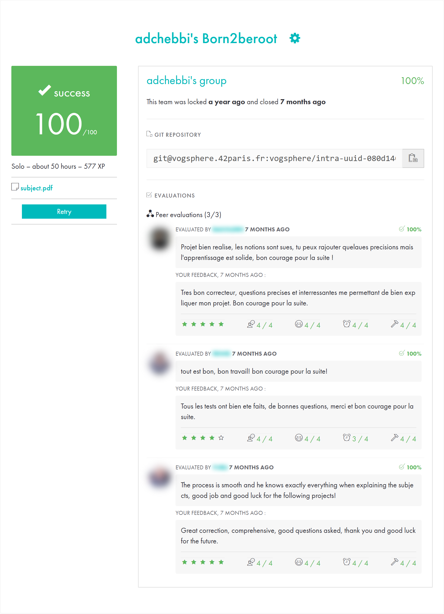

*This project has been created as part of the 42 curriculum by adchebbi.*

# Born2beRoot

> System administration project: install and harden a Debian server in a virtual machine (no graphical
> interface) with encrypted LVM partitions, SSH, a firewall, strict sudo and password policies, and a monitoring
> script run by cron.

   

## What was configured

| Area | Configuration |
|---|---|
| Virtualization | VirtualBox VM, Debian stable, no GUI |
| Disk | LVM on an **encrypted** partition, separate logical volumes |
| SSH | Port **4242**, root login disabled |
| Firewall | **UFW** enabled at boot, only port 4242 open |
| Mandatory access control | **AppArmor** enabled |
| Users | Dedicated user in the `sudo` and `user42` groups |
| sudo | Limited password attempts, custom error message, every command logged, TTY required, restricted paths |
| Password policy | Expiry and minimum age, minimum length, mixed character classes, max consecutive identical characters |
| Monitoring | `monitoring.sh` broadcast to all terminals (`wall`) every 10 minutes via `cron` |

The repository contains `signature.txt`: the SHA-1 checksum of the virtual disk at submission time, used during
evaluation to prove the VM was not modified.

## monitoring.sh

A Bash script that reports, every 10 minutes:

- OS architecture and kernel version
- physical and virtual CPU count, CPU load
- RAM and disk usage (used / total, percentage)
- last reboot time, whether LVM is active
- number of active TCP connections and logged-in users
- server IPv4 and MAC address
- number of commands run with `sudo`

## Technical choices

- **Debian vs Rocky Linux**: Debian is community-driven, stable, well documented and simpler to configure.
  Rocky is enterprise-oriented and uses SELinux.
- **AppArmor vs SELinux**: AppArmor uses path-based profiles and is easier to manage. SELinux uses labels and
  offers finer, but more complex, control.
- **UFW vs firewalld**: UFW is a simple front-end to netfilter and is Debian's natural choice.
- **LVM**: logical volumes can be resized without repartitioning. Separate partitions stop a full `/var/log`
  from taking down the whole system.
- **Disk encryption**: protects data against physical access to the disk.

## Resources

- [Debian Administrator's Handbook](https://debian-handbook.info/)
- Man pages: `sudoers(5)`, `login.defs(5)`, `pam_pwquality(8)`, `ufw(8)`, `sshd_config(5)`, `crontab(5)`, `lvm(8)`

### AI usage

AI was used to clarify concepts (LVM, security tools) and to structure this README. All configurations were
implemented manually.

## 42 evaluation

Validated at **100/100** by 3 peer evaluations.
Other students' names and photos are blurred.

## Author

**Adem Chebbi** ([@ademchbb](https://github.com/ademchbb)), 42 login `adchebbi`
